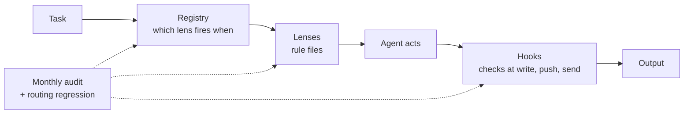

# os

**My product judgment, written so AI agents can run it, and tested monthly to prove they still do.**

I run partner success in adtech, getting enterprise partners from "interested" to live, and I build most things through AI agents. Early on, the agents' failures were judgment failures: a polished partner email that asked for nothing, a feature green-lit because one loud partner wanted it.

So I wrote my judgment down as **lenses**: short rule files an agent reads before it acts. This repo is the public part of that system.

**See it work:** [the same partner email reviewed with and without the taste lens](examples/taste.md).

## Lenses

| Lens | Runs when |
|---|---|
| [`taste`](lenses/taste.md) | Last, before anything outside the team sees an artifact. Returns ship, ship with fixes, or not yet, with the why and rewritten text. |
| [`anti-ai`](lenses/anti-ai.md) | Before shipping AI-assisted code, decks, docs or analysis. Catches the tells writing checkers miss. |

Each lens is a markdown file with skill-style frontmatter. Drop it into a skills folder as `taste/SKILL.md`, or paste it into any agent's instructions.

## How the full system works

1. **Lenses.** Short files of numbered rules, each with a stated trigger: product, motivation, strategy, taste, commercial, design and more. Two are published here so far.
2. **Registry.** One file lists every lens and the situation that fires it, and nothing else lists them. I learned that rule the hard way: twice, a hand-written list went stale and lenses silently stopped firing.
3. **Hooks.** Scripts that turn the most important rules into mechanisms: a content-safety scan before any push or PR, a design gate before the first UI edit, a block on pushing to main. One is published as an example: [`enforcement/no-ai-artifact-md.sh`](enforcement/no-ai-artifact-md.sh).

## Testing

Prompt systems rot quietly. Someone rewords a trigger, a real task stops reaching the lens it needs, and nothing errors.

**Routing regression.** Nine real tasks run through fresh headless agent sessions. Each run checks which lenses the agent opened, and which it shouldn't have. Most lenses named below are in my private set; `taste` is published.

| Task | Must open | Must not open |
|---|---|---|
| Tighten a partner email before sending | motivation, taste | |
| Partner asks for a custom ranking feature | product, motivation | |
| Should we build a self-serve preview tool? | product | |
| Positioning doc for a new partner segment | strategy, retail media | |
| Coach a direct report on discovery-call notes | motivation, taste | |
| Run the product-sense lens on an SDK placement question | ps-lens, taste | |
| Update a README | | taste |
| Build a new UI component | design, workflow gates | |
| Open the PR for a UI change | de-ai-ify | |

**Last run, 2026-10-11: 8 of 9 pass.** The miss: asked to open the PR for a UI change, the agent ran the code and safety checks but never reached for the AI-slop design check on its own. Written rules alone missed it. In my live setup, a ship gate blocks that push until the check has run, and that's why the gate exists.

**Monthly audit.** Automated checks for broken cross-references, unregistered lens files, hooks pointing at missing scripts, the same principle restated in two places (which is how drift starts), and whether the workflow gates are actually followed.

Most of those checks exist because something broke without anyone noticing. In one case, a hardcoded file list let two new lenses go unchecked for weeks. The fix was to derive the list from the registry so it can't be hardcoded again.

## Deliberately not here

- **Employer and partner context.** Partner names, revenue numbers and internal schemas stay private. The lenses work without them.
- **Most of the enforcement layer.** The hooks are wired to my machine and accounts. One sanitized example is included.
